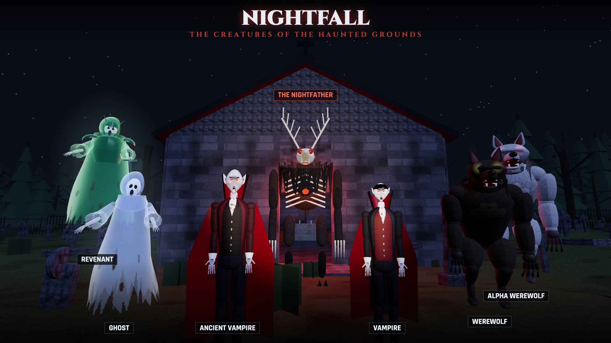

# NIGHTFALL: THE HAUNTED GROUNDS

Een 3D first-person horror survival shooter die volledig in de browser draait. Overleef golf na golf vampiers, weerwolven, geesten, elitemonsters en uiteindelijk **The Nightfather**, de eindbaas uit het donkere bos.



Gebouwd met **Three.js**, **Vite** en de **Web Audio API**. Alle 3D-modellen, texturen, animaties en geluiden worden procedureel gegenereerd tijdens het laden: er zijn geen externe assets.

## Functionaliteiten

- **Echte first-person besturing** met Pointer Lock, sprinten met stamina, springen, head bob, landingsdip, terugslag en camera shake.
- **Eén grote, verbonden wereld** (ca. 340 × 280 m):
  - *Blackwood Manor*: spookhuis met entreehal, grote trap, bibliotheek, eetkamer, keuken, studeerkamer, slaapkamers op de bovenverdieping en een kelder met ritueel, kerkers en wijnkelder. Alle kamers zijn betreedbaar en deuren kunnen open en dicht.
  - *De grote begraafplaats*: honderden grafstenen, vier mausolea, een kapel met klokkentoren, een ondergrondse grafkelder, standbeelden, dode bomen, kapotte ijzeren hekken en kronkelpaden.
  - *Het donkere bos*: ruim 1.300 bomen, rotsen, omgevallen stammen, hutten, een verlaten schuilplaats, open plekken en een rituele steencirkel waar de eindbaas ontwaakt.
  - Verbonden via een oprijlaan, vervallen poorten en een smal pad achter het landhuis.
- **Vijf wapens**: pistool, shotgun (9 hagelkorrels), assault rifle (automatisch), Holy Crossbow (zilveren projectielen met lichtspoor, ×4 schade tegen geesten) en een brandbijl (melee). Raycast-hits met hoofd- en lichaamstreffers, munitie, herladen, mondingsflitsen, inslagen, kogelgaten en tracers.
- **Vier vijandtypen + elites + eindbaas**, elk met een eigen gesculpt 3D-model (organische vormen, huid-, vacht- en stoftexturen, wapperende capes en gewaden), animatie, gedrag en geluid:
  - Vampier: snel, korte dash-aanvallen. *Ancient Vampire*: teleporteert achter je en steelt leven.
  - Weerwolf: ziet je van ver, sprint in een flankerende boog en springt. *Alpha Werewolf*: brul die de roedel opjaagt, grondslag bij landing.
  - Geest: zweeft, fase-verschuift (kogels gaan er dan doorheen), teleporteert en vuurt spectrale energie. *Revenant*: gepantserde geestridder met salvo's.
  - *The Nightfather*: enorm gewei-monster met klauwslag, grondschokgolf (spring om te ontwijken), charge, bloedsalvo's, oproepen van handlangers en woede-fase.
- **Herbruikbare vijand-AI** met toestanden Idle, Patrol, Investigate, Chase, Attack, Stagger en Dead, gelaagd A*-navigatiegrid (kelder, begane grond, bovenverdieping) met trapportalen, deuren openen, separatie, gehoor en anti-vastloopherstel.
- **Golfsysteem**: 5 → 8 → 12 → 16 → 20 vijanden. De eerste drie golven zijn een rustige opwarming (zwakkere, tragere vijanden, minder tegelijk, extra munitie tussen golven en elke kill geeft wat leven terug), elites vanaf golf 5, baasgolf op 10, daarna eindeloos met stijgende HP, schade, snelheid en agressie. Spawnpunten buiten zicht, geen dubbele golfstarts, anti-stall.
- **Punten en upgrades** (TAB tussen golven): gezondheid, schade, herlaadsnelheid, munitiecapaciteit, bewegingssnelheid, betere zaklamp, pantser, munitie, medkit en het vrijspelen van wapens.
- **Verkenning**: munitiekisten, medkits, pantser, leesbare notities, wapens op logische plekken en drie geheime voorraden.
- **Horrorsfeer**: maanlicht met schaduwen, mist, flikkerende lampen en kaarsen, bliksem, gloeiende ogen, schaduwfiguren tussen de bomen, gezichten in ramen en spiegels, en een zeldzame volledige jumpscare.
- **Procedurele audio**: wind, wolvengehuil, vleermuizen, gefluister, krakende vloeren, voetstappen per oppervlak, ruimtelijke vijandgeluiden en wapengeluiden.
- **Dynamisch hoofdmenu** met een filmische camera door de echte 3D-wereld, zwevende geesten, bliksem, gloeiende as-deeltjes, flikkerende titel en roterende lore.
- **Instellingen**: master, effecten, muziek, muisgevoeligheid, FOV, grafische kwaliteit (Low/Medium/High), muis-Y omkeren en head bob.

## Besturing

| Toets | Actie |
| --- | --- |
| W A S D | Bewegen |
| Muis | Rondkijken |
| Linkermuisknop | Schieten / aanvallen |
| Rechtermuisknop | Richten (ADS) |
| Shift | Sprinten |
| Spatie | Springen |
| R | Herladen |
| F | Zaklamp aan/uit |
| E | Interactie / oppakken / notitie lezen |
| 1 2 3 4 5, scrollwiel, Q | Wapen wisselen (Q = vorig wapen) |
| TAB | Upgrades (tussen golven) |
| N | Volgende golf direct starten |
| Esc | Pauze |

## Spelen op iPhone en iPad

De game herkent aanraakschermen automatisch en schakelt dan over op schermbediening:

| Bediening | Actie |
| --- | --- |
| Linkerduim (overal op de linkerhelft) | Zwevende joystick om te lopen; helemaal naar voren duwen = sprinten |
| Rechterduim | Vegen om rond te kijken |
| FIRE | Schieten; slepen over de knop stuurt tegelijk het richten |
| AIM · JUMP · R · ⇄ | Richten (aan/uit) · springen · herladen · volgend wapen |
| USE | Verschijnt bij deuren, voorwerpen en notities |
| Bovenbalk: LIGHT · UPGRADES · NEXT WAVE · ☰ | Zaklamp · upgrades en volgende golf (tussen golven) · menu |
| Wapennummers rechtsboven | Tik om direct van wapen te wisselen |

- Speel in liggende stand; in staande stand verschijnt een melding om het toestel te draaien.
- Lichte richthulp trekt het vizier zacht naar de dichtstbijzijnde vijand terwijl je schiet of richt.
- Telefoons starten op grafische kwaliteit *Low* en tablets op *Medium*; je kunt dit wijzigen in Settings.
- Tip: kies in Safari **Deel → Zet op beginscherm** voor schermvullend spelen zonder adresbalk.
- Testen op desktop: voeg `?touch` toe aan de URL om de aanraakbediening te forceren, of `?desktop` om hem uit te zetten.

## Lokaal draaien

Vereist Node.js 20 of nieuwer.

```bash
npm install
npm run dev
```

Open daarna http://localhost:5180 en klik op **PLAY**.

## Production build

```bash
npm run build
npm run preview
```

De build komt in `dist/`. Vite gebruikt `base: './'`, dus alle paden zijn relatief en de build werkt op elke submap, inclusief GitHub Pages.

## Publiceren op GitHub Pages

Live: **https://spacr23.github.io/nightfall/**

Er zijn twee manieren om te publiceren:

**A. Automatisch met GitHub Actions (aanbevolen).** De workflow in `.github/workflows/deploy.yml` bouwt en publiceert bij elke push naar `main`.

1. Push de repository naar GitHub. Je token heeft daarvoor de `workflow`-scope nodig (`gh auth refresh -h github.com -s workflow`).
2. Ga naar **Settings → Pages** en kies bij *Source* voor **GitHub Actions**.
3. Na de eerste succesvolle run staat het spel op `https://<gebruikersnaam>.github.io/<repository>/`.

**B. Handmatig via de `gh-pages`-branch.** Werkt zonder Actions:

```bash
npm run deploy
```

Dit bouwt het project en zet `dist/` op de branch `gh-pages`. Kies in **Settings → Pages** dan *Deploy from a branch* met `gh-pages` en `/ (root)`.

## Projectstructuur

```
src/
  main.js                 opstart en laadscherm
  game/                   Game (orchestrator), GameState, InputManager, Physics (AABB + spatial hash),
                          NavGrid (gelaagde A*), AudioManager, LightPool, Combat, Projectiles, Upgrades, Settings
  player/                 Player, PlayerController, PlayerHealth, WeaponManager
  weapons/                Weapon (basis) + Pistol, Shotgun, AssaultRifle, HolyCrossbow, FireAxe, WeaponModels
  enemies/                Enemy, EnemyAI, Vampire, Werewolf, Ghost, Boss, EnemyModels, EnemyFactory
  waves/                  WaveManager, SpawnManager
  world/                  WorldBuilder, Terrain, Paths, Props, Materials, HauntedMansion, Cemetery, DarkForest
  effects/                Effects, ParticleEffects, DamageEffects, Scares (jumpscares en atmosfeer)
  ui/                     HUD, Menus (hoofdmenu, pauze, instellingen, upgrades, game over)
  styles/main.css
```

## Performance

- Statische geometrie wordt na het bouwen per materiaal en per gebied van 40 m samengevoegd (van ~3.000 naar ~300–550 draw calls).
- Bomen, grafstenen, rotsen, struiken en gras zijn `InstancedMesh`es, opgesplitst in chunks voor frustum culling.
- Een vaste pool van puntlichten wordt telkens aan de dichtstbijzijnde lichtbronnen toegewezen, zodat shaders niet opnieuw compileren.
- Eén schaduwcasterend maanlicht dat met de speler meeschuift; zaklampschaduwen alleen op High.
- Deeltjes draaien in twee gepoolde `THREE.Points`-draw calls.

## Testmodi

- `?debug` laat het spel draaien zonder echte pointer lock, handig voor geautomatiseerde browsertests.
- `?debug&manual` zet de animatielus uit; frames kun je dan stappen met `window.__nightfall.step(n)`.

## Bekende beperkingen

- Op iPhone en iPad is de game getest met gesimuleerde aanraakinvoer op iPhone- en iPad-formaat; prestaties hangen af van het toestel.
- Alle modellen zijn gestileerd en procedureel opgebouwd uit primitieve vormen, niet gesculpt.
- Botsingen gebruiken assen-uitgelijnde boxen; schuine objecten hebben een iets ruimere botsingsbox.
- Vijandnavigatie gebruikt een grid van 1 m. Grote vijanden kunnen soms even tegen een hoek schuren voordat het anti-vastloopsysteem ingrijpt.
- Wijzigingen in grafische kwaliteit die het aantal deeltjes of gras bepalen worden pas na een herlaad volledig toegepast.
- Browsers vereisen een klik voordat audio en pointer lock starten; na Esc kan het een seconde duren voordat de muis opnieuw vergrendeld kan worden.

## Credits

Ontwerp en code: procedureel gegenereerd met Three.js. Lettertypen: Cinzel en Rajdhani (Google Fonts, SIL Open Font License).
